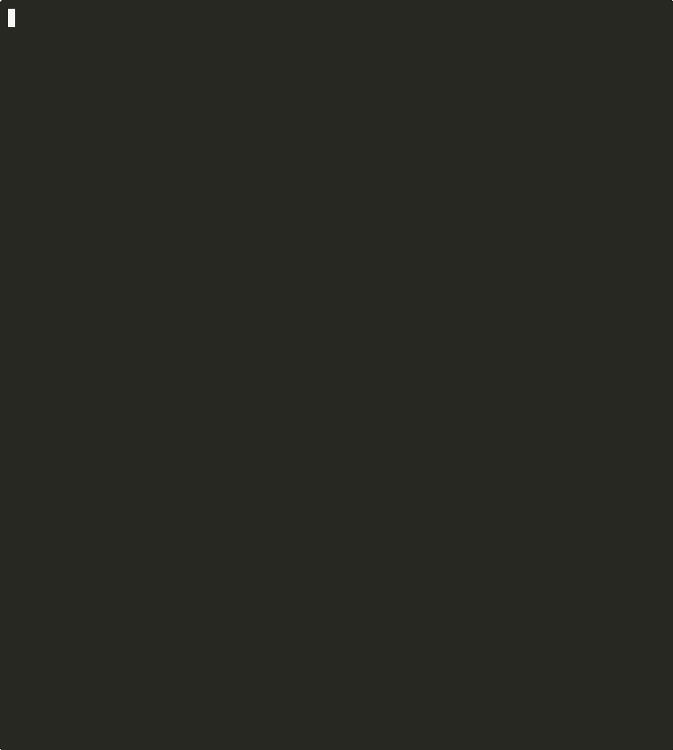

# ura-donut

A spinning ASCII donut written in [ura](https://github.com/ura-computing/ura-lang).

<p align="center">
  
</p>

<p align="center"><a href="assets/ura-donut.mp4">video (mp4)</a></p>

## Run it

```
git clone https://github.com/ura-computing/ura-donut
cd ura-donut
ura deps install
ura run
```

## Files

| file | what it shows |
|---|---|
| main.ura | runs the donut, it spins until ctrl+c |
| src/donut.ura | `template<T>: struct Grid` over `Array<T>`, `operator []`, a nested fn with `match`, `for ... in Range`, a `String` of shades, `sin` / `cos` from ura-math |
| src/colors.ura | `enum Color` + `match` for terminal colours, `String.repeat` |

## Requirements

| | |
|---|---|
| ura | [ura-lang](https://github.com/ura-computing/ura-lang) |
| OS | Linux, macOS |
| dependencies | [ura-core](https://github.com/ura-computing/ura-core), [ura-math](https://github.com/ura-computing/ura-math), [ura-posix](https://github.com/ura-computing/ura-posix) 0.0.1, cloned by `ura deps install` |
